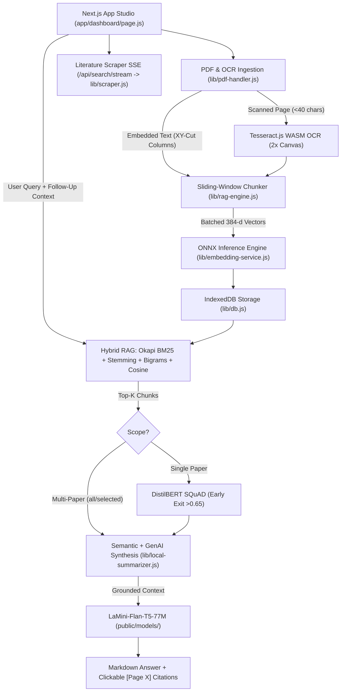

# LocalResearcher — Codebase Analysis, System Architecture, Tech Stack & Project Flow

LocalResearcher (`v1.5.0`) is a **100% local, privacy-first academic intelligence platform** and **Node.js/ESM SDK** for ingesting, indexing, summarizing, comparing, and querying research papers with zero required user API keys.

---

## 1. Codebase Analysis

### A. Core AI, NLP, OCR & Data Engines (`lib/`)

| File | Responsibility & Key Symbols |
| :--- | :--- |
| `lib/pdf-handler.js` | Client-side PDF parsing via `pdfjs-dist` (`parsePdfFile`), concurrent page extraction, XY-cut horizontal band segmentation (`single-column`, `2-column`, `3-column`, `mixed`), soft-hyphen de-wrapping, margin page-number filtering, font-size title/author detection (`detectTitleFromFontData`, `detectAuthorsFromFontData`), and automatic 2x canvas **Tesseract OCR** fallback (`extractTextWithOCR`, `getOcrWorker`) for scanned PDFs. |
| `lib/embedding-service.js` | Manages promise-locked local ONNX/WASM model singletons (`getEmbeddingPipeline`, `getQAPipeline`, `getGenAIPipeline`) loaded from `/models/` (`public/models/`). Provides `generateEmbedding` (with 600-entry LRU cache), unit-vector fast-path `cosineSimilarity`, `answerQuestion` (DistilBERT SQuAD), and `generateLocalResponse` (LaMini-Flan-T5-77M with 8s timeout). |
| `lib/rag-engine.js` | Sliding-window chunking (`chunkPageText`) with section tagging (`abstract`, `introduction`, `methodology`, `experiments`, `results`, `discussion`, `conclusion`). Tokenization with morphological stemming (`stemToken`), `WeakMap`-cached chunk analysis (`chunkAnalysisCache`), bigram phrase extraction (`extractBigrams`), bounded Levenshtein typo correction, query intent classification (`classifyQueryIntent`), and **Hybrid Okapi BM25 + Dense Vector Retrieval** (`retrieveChunks`). |
| `lib/local-summarizer.js` | Academic text normalization (`cleanAcademicText`), abbreviation-safe sentence splitting (`splitSentences`), **Salience-Weighted TextRank with MMR** ($\lambda = 0.72$, `textRankSummary`), parallel section extraction with semantic RAG infilling (`getSectionTextOrRagFallback`, `generateLocalSummary`), dataset/keyword/acronym/metric extraction (`detectDatasets`, `extractKeywords`, `extractAcronyms`, `extractNumericalResults`), standalone `summarizePassage`, and grounded GenAI + semantic **Chat Synthesis** (`synthesizeAnswer`). |
| `lib/db.js` | Browser persistence layer using `IndexedDB` (`LocalResearcherDB` with `papers` and `chats` object stores) for unbounded offline storage of papers, 384-dim embeddings, and chat histories, with automatic `localStorage` fallback. |
| `lib/scraper.js` | Concurrent multi-source academic search (`SCRAPER_MAP`) across **arXiv**, **PubMed**, **Semantic Scholar**, **CrossRef**, **MDPI**, **Springer**, and **IEEE** with exponential backoff retries (`withRetry`). |
| `lib/ai-service.js` | Optional LangChain adapter layer (retained for SDK compatibility when an optional external key is passed) with parallelized model + message imports. |
| `lib/demo-data.js` & `lib/utils.js` | Sample/demo paper payloads and Tailwind `cn()` class-merge utility. |

---

### B. App Router Pages & API Routes (`app/`)

| Route / File | Role |
| :--- | :--- |
| `app/layout.js` | Root layout loading Google Fonts (`Inter`, `Playfair_Display`, `JetBrains_Mono`), `ThemeProvider`, `MotionProvider` (`LazyMotion` + `domAnimation`), and `Footer`. |
| `app/globals.css` | Tailwind v4 `@theme` design tokens, obsidian dark palette (`#09090b` background, `#111114`/`#141418` surfaces, `#38bdf8` accent), markdown typography, and `.citation-link` badge styles. |
| `app/page.js` | Landing page showcasing the anti-hallucination RAG architecture, token-limit comparison, and NPM/PNPM/Bun install bar. |
| `app/dashboard/page.js` | Core interactive studio (`DashboardPage`) with 6 views: **Overview**, **Literature Search**, **Library & Uploader** (with batch summarize, batch BibTeX export, and side-by-side **Compare Matrix** `<dialog>`), **Intelligence / Summarizer**, **Semantic Chat** (`@all`, `@selected`, `@paper` scopes + clickable `[Page X]` citations), **Structured Archive** (CSV/Markdown/PDF ledger export), and **Settings** (RAG chunking & Local Intelligence Engine status). |
| `app/docs/page.js` | Web platform & NPM SDK documentation. |
| `app/architecture/page.js` | Visual architecture overview page. |
| `app/manifesto/page.js` | Project design philosophy and manifesto. |
| `app/skill/page.js` | Showcases `.agents/skills/research-skill-localresearcher/SKILL.md` and `npm run download-models`. |
| `app/api/search/route.js` & `app/api/search/stream/route.js` | Next.js App Router endpoints (`POST /api/search` and Server-Sent Events `GET /api/search/stream`) executing `SCRAPER_MAP` academic queries. |

---

### C. UI Components, SDK, Scripts & Agent Skills

- **UI Components (`components/`)**: `navbar.jsx`, `marketing-nav.jsx`, `home.jsx`, `footer.jsx`, and shadcn/base-ui primitives (`ui/button.jsx`, `ui/tabs.jsx`, `ui/dropdown-menu.jsx`).
- **NPM Library Entry (`src/index.js`)**: Exports `LocalResearcher` (and `ScholarEngine` alias) with `processPaper` / `ingest` and `askQuestion` / `query` for Node.js pipelines.
- **Model Downloader (`scripts/download-models.mjs`)**: Pre-downloads all 3 quantized ONNX models into `public/models/Xenova/`.
- **Agent Skill (`.agents/skills/research-skill-localresearcher/SKILL.md`)**: Project-specific coding & verification skill.

---

## 2. System Architecture

---

## 3. Tech Stack

| Layer | Technologies |
| :--- | :--- |
| **Framework & Runtime** | Next.js `16.2.9` (App Router, Webpack mode), React `19.2.4`, Node.js ESM (`"type": "module"`) |
| **Local AI / ONNX Models (`public/models/`)** | `@xenova/transformers` (`2.17.2`): `Xenova/all-MiniLM-L6-v2` (embeddings), `Xenova/distilbert-base-uncased-distilled-squad` (extractive QA), `Xenova/LaMini-Flan-T5-77M` (local GenAI Seq2Seq synthesis) |
| **PDF & OCR Parsing** | `pdfjs-dist` (`^4.0.379`) + `tesseract.js` (`^7.0.0`) |
| **Client Persistence** | Browser `IndexedDB` (`LocalResearcherDB`) with `localStorage` fallback |
| **Styling & Motion** | Tailwind CSS v4 (`@tailwindcss/postcss`), `tw-animate-css`, `shadcn` / `@base-ui/react`, `lucide-react`, `motion/react` (`LazyMotion` + `domAnimation`) |
| **Markdown & Sanitization** | `marked` (`^18.0.5`) + `isomorphic-dompurify` (`^4.3.0`) |
| **Academic Scraping** | `axios` + `cheerio` |
| **Tooling** | ESLint `9` (`eslint-config-next`), `patch-package`, `react-doctor` |

---

## 4. End-to-End Project Flow

1. **Document Ingestion & Layout Reconstruction**:
   - User drops up to 5 PDFs in the dashboard (or calls `ingest()` in the SDK).
   - `parsePdfFile()` reads pages concurrently via `pdfjs-dist`.
   - Pages with an embedded text layer undergo **XY-cut horizontal band segmentation** (`single-column`, `2-column`, `3-column`, or `mixed`), margin page-number filtering, and soft-hyphen de-wrapping (`transfor-\nmer` → `transformer`).
   - Pages without a readable text layer (`< 40` chars) are rendered at `2.0x` scale and processed locally by the singleton **Tesseract OCR** worker (`layout: "ocr-scanned"`).
2. **Chunking, Embedding & Local Persistence**:
   - `chunkPageText()` splits each page into overlapping chunks (`chunkSize = 800`, `overlap = 150`) and tags section heuristics (`methodology`, `results`, etc.).
   - `generateEmbedding()` encodes chunks in batches of 8 using quantized `all-MiniLM-L6-v2` (384-dim unit vectors) and saves the paper + embeddings to `IndexedDB`.
3. **Structured Summarization & Ledger Extraction**:
   - `generateLocalSummary()` extracts sections in parallel (`Promise.all`), infilling missing headers via semantic RAG (`getSectionTextOrRagFallback`).
   - Sentences are split with academic abbreviation protection (`et al.`, `Fig.`, `Eq.`) and ranked via **Salience-Weighted TextRank + MMR** ($\lambda = 0.72$).
   - `extractLocalMetadata()`, `detectDatasets()`, `extractAcronyms()`, and `extractNumericalResults()` populate the **Structured Archive** table and **Cross-Paper Compare Matrix**.
4. **Semantic Chat & Grounded Q&A**:
   - `handleSendMessage()` strips `@scope` mentions and enriches short or pronoun-based follow-up queries with the previous user turn.
   - `retrieveChunks()` scores all scoped chunks using **Okapi BM25** (with morphological stemming, bigram phrase boost, and bounded Levenshtein typo correction) fused with dense cosine similarity and section-intent boosting.
   - Single-paper queries run `answerQuestion()` (DistilBERT SQuAD with early exit at `score > 0.65`) and pass `{ directAnswer, directPage }` into `synthesizeAnswer()`. Multi-paper queries route directly to `synthesizeAnswer()`.
   - `synthesizeAnswer()` ranks sentences via hybrid semantic + lexical scoring, generates a strictly grounded **AI Synthesis** via `LaMini-Flan-T5-77M` (`generateLocalResponse`), appends clickable `[Page X]` citations and **Supporting Evidence** blockquotes, and guards against hallucinations with low-confidence detection.
