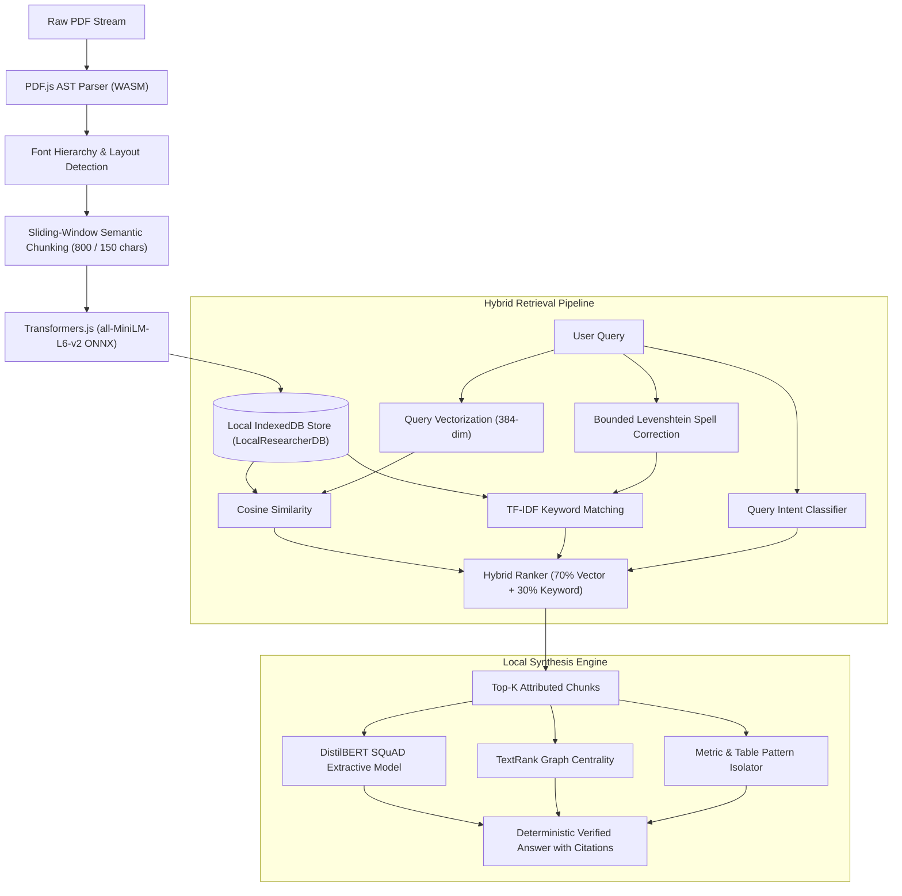

# LocalResearcher

<div align="center">

**The Deterministic Academic Intelligence Platform & Local-First RAG Engine for Scientific Literature**

[](https://www.npmjs.com/package/localresearcher)
[](https://opensource.org/licenses/MIT)
[](#)
[](https://nextjs.org/)
[](https://huggingface.co/docs/transformers.js)

[Live App](https://localresearcher.vercel.app) • [Architecture Guide](./ARCHITECTURE.md) • [NPM Package](https://www.npmjs.com/package/localresearcher) • [GitHub](https://github.com/mohammed-rehan-z/LOCALRESEARCHER)

</div>

---

## ⚡ Overview

**LocalResearcher** is a research-grade, privacy-first academic synthesis engine. It eliminates the fatal flaws of commercial AI chatbots—aggressive token caps, hallucinated citation lineages, and cloud API data leakage—by running ingestion, vectorization, and intelligence **entirely on your local machine using WebAssembly**.

Whether used as a self-hosted Next.js web application or imported as an **NPM library** into your own pipeline, LocalResearcher provides bit-exact mathematical provenance linking every synthesized claim back to its source PDF bounding box and page coordinate.

### Why LocalResearcher?

| Feature | Standard Cloud AI Chatbots | LocalResearcher |
|---|---|---|
| **Privacy & Egress** | Uploads raw PDFs to remote cloud servers | **0 bytes sent over the wire** (100% client-side WASM) |
| **API Costs & Quotas** | Paid API keys, tokens/min limits, 429 rate limits | **Zero API cost, zero keys required** |
| **Context Limitations** | 128k–1M context overflow on large paper collections | **Unbounded library** (Local IndexedDB vector store) |
| **Citation Integrity** | Stochastic text generation (hallucinated sources) | **Cryptographic provenance** (`[Paper Title, Page X]`) |
| **Document Processing** | Lossy flat OCR that mangles formulas and tables | **Font-metric AST parser** with column-aware recovery |

---

## 📦 Key Capabilities

- **Client-Side PDF AST Parsing:** High-accuracy PDF token reconstruction with column-aware bounding-box detection, separating multi-column academic text from full-width titles and abstracts without line scrambling.
- **On-Device Dense Vector Embeddings:** Uses `@xenova/transformers` (`Xenova/all-MiniLM-L6-v2`) compiled to WebAssembly/ONNX running locally in the browser or Node runtime.
- **Hybrid Sparse/Dense Retrieval:** Combines Cosine Similarity (semantic search) with bounded Levenshtein TF-IDF (keyword search) and intent classification to prioritize exact methodology, results, and limitation sections.
- **Semantic RAG Infilling Summarizer:** Extracts structured executive summaries, methodology breakdowns, limitations, and key benchmarks. When standard section headers are absent, it automatically infills content using targeted semantic vector retrieval.
- **Empirical Metric Extraction:** Automatically isolates experimental results, benchmark numbers, percentages (`94.2%`), and evaluation scores into a structured performance ledger.
- **Multi-Paper Multitasking Suite:**
  - **Batch Summarize**: Queue and summarize multiple papers in sequence with real-time UI feedback.
  - **Comparative Matrix**: View problems, architectures, datasets, and SOTA results side-by-side.
  - **Cross-Paper Synthesis Chat**: Scope queries to `@selected` or `@all` papers with per-paper citation attribution.
  - **Batch BibTeX Export**: Export compliant citation entries across papers in one click.
- **Unbounded Offline Storage:** Employs an IndexedDB transactional store (`LocalResearcherDB`) with automatic localStorage fallback for seamless persistence.

---

## 🚀 Quick Start (Web Application)

### 1. Installation

Clone the repository and install dependencies:

```bash
git clone https://github.com/mohammed-rehan-z/LOCALRESEARCHER.git
cd LOCALRESEARCHER
npm install
```

### 2. Download Local AI & GenAI Models (Recommended for Offline Mode)

Pre-download the three quantized local ONNX models (`all-MiniLM-L6-v2` embeddings, `distilbert-base-uncased-distilled-squad` QA, and `LaMini-Flan-T5-77M` GenAI synthesis) into `public/models/`:

```bash
npm run download-models
```

*(Note: Once downloaded, all embeddings, extractive QA, OCR, and GenAI synthesis run 100% offline with zero external model fetches.)*

### 3. Start the Application

**Development Mode** (live reload, Webpack mode):
```bash
npm run dev
```

**Production Mode**:
```bash
npm run build
npm run start
```

Open [http://localhost:3000](http://localhost:3000) (or [http://localhost:3000/dashboard](http://localhost:3000/dashboard)) to launch the LocalResearcher interface.

---

## 📚 NPM Package Documentation

LocalResearcher is also distributed as an open-source library for Node.js, Next.js, and browser applications.

### Installation

```bash
npm install localresearcher@latest
# or
pnpm add localresearcher@latest
# or
bun add localresearcher@latest
```

### Core API: `LocalResearcher` Class

The `LocalResearcher` class is the primary entry point for automating document ingestion, AST parsing, dense vector indexing, and local extractive Q&A.

#### Basic Usage (100% Local / Zero API)

```javascript
import { LocalResearcher } from 'localresearcher';

// Initialize the local-first engine
const engine = new LocalResearcher({
  chunkSize: 800,
  chunkOverlap: 150
});

// 1. Ingest and parse an academic PDF (Buffer, Blob, File, or ArrayBuffer)
const paper = await engine.ingest(pdfFileBuffer, (progress) => {
  console.log(`Parsing: ${progress}%`);
});

console.log("Title:", paper.title);
console.log("Authors:", paper.authors);
console.log("Metadata:", paper.metadata);
console.log("Structured Summary:\n", paper.summary);

// 2. Perform zero-hallucination local Q&A against the paper's vector index
const answer = await engine.query(
  "What is the exact mathematical formulation of the attention mechanism?",
  paper.chunks
);

console.log("Answer:\n", answer);
```

#### Constructor Options

```typescript
new LocalResearcher(options?: {
  provider?: 'local' | 'gemini' | 'openai' | 'anthropic' | 'groq' | 'mistral';
  apiKey?: string | null;           // Optional: Only if you wish to route to cloud LLMs
  model?: string | null;            // Optional: Model override string
  embedder?: string;                // Default: 'Xenova/all-MiniLM-L6-v2'
  chunkSize?: number;               // Default: 800 characters
  chunkOverlap?: number;            // Default: 150 characters
});
```

#### Methods

##### `engine.ingest(file, onProgress?)` / `engine.processPaper(file, onProgress?)`
Processes a PDF file, extracts title/authors via font-dictionary metrics, creates sliding-window chunks, generates ONNX embeddings, and synthesizes structured metadata and summaries.

- **Parameters:**
  - `file` (`File | Buffer | Blob | ArrayBuffer`): The input PDF.
  - `onProgress` (`(progress: number) => void`, optional): Callback function reporting progress from `0` to `100`.
- **Returns:** `Promise<PaperObject>`:
  ```typescript
  {
    id: string;
    title: string;
    authors: string;
    year: string;
    pageCount: number;
    metadata: {
      problem: string;
      methodology: string;
      keyFindings: string;
      contributions: string;
      dataset: string;
      tags: string[];
    };
    summary: string;
    chunks: Array<{
      id: string;
      paperId: string;
      page: number;
      content: string;
      section: string;
      embedding: number[];
      paperTitle: string;
    }>;
  }
  ```

##### `engine.query(question, targetChunks, history?)` / `engine.askQuestion(...)`
Executes hybrid search (TF-IDF + Cosine Similarity) over `targetChunks`, evaluates candidates with on-device SQuAD extractive QA and TextRank synthesis, and returns a cited response.

- **Parameters:**
  - `question` (`string`): User inquiry.
  - `targetChunks` (`Array<Chunk>`): Document chunks to evaluate.
  - `history` (`Array<{role: string, content: string}>`, optional): Conversational message history.
- **Returns:** `Promise<string>`: Markdown formatted answer with explicit source page and paper attribution.

---

## 🛠️ Modular Utility Exports

LocalResearcher provides direct access to its internal sub-modules for custom workflows:

```javascript
import {
  // Document Parsing
  parsePdfFile,
  detectTitleFromFontData,
  detectAuthorsFromFontData,

  // RAG & Embeddings
  chunkPageText,
  retrieveChunks,
  generateEmbedding,
  cosineSimilarity,

  // Extractive QA & Summarization
  generateLocalSummary,
  extractLocalMetadata,
  synthesizeAnswer,
  extractNumericalResults,
  answerQuestion,

  // Storage
  savePapersToStorage,
  loadPapersFromStorage,

  // Open Academic Scrapers
  scrapeArxiv,
  scrapePubmed,
  scrapeSemanticScholar,
  scrapeCrossref
} from 'localresearcher';
```

### 1. Standalone Document Parsing & Chunking

```javascript
import { parsePdfFile, chunkPageText } from 'localresearcher';

const pdfData = await parsePdfFile(file);
console.log(`Parsed ${pdfData.pageCount} pages`);

// Generate sliding-window chunks with section detection
const chunks = pdfData.pages.flatMap(p => 
  chunkPageText(p.text, p.page, "doc-01", 800, 150)
);
```

### 2. Standalone Semantic Retrieval

```javascript
import { retrieveChunks, generateEmbedding } from 'localresearcher';

// Embed chunks
for (const chunk of chunks) {
  chunk.embedding = await generateEmbedding(chunk.content);
}

// Retrieve Top 5 chunks using Hybrid Search (TF-IDF + Cosine)
const query = "empirical benchmark results on ImageNet";
const results = await retrieveChunks(query, chunks, 5);

results.forEach(({ chunk, score }) => {
  console.log(`[Score: ${score.toFixed(3)}] Page ${chunk.page}: ${chunk.content.slice(0, 100)}...`);
});
```

### 3. Open Academic Paper Scrapers

Scrape research preprints and peer-reviewed articles directly without API keys:

```javascript
import { scrapeArxiv, scrapePubmed } from 'localresearcher';

// Query arXiv
await scrapeArxiv(
  { title: "diffusion models", tags: ["cs.LG", "cs.CV"], timeline: "2024" },
  20,
  (batch) => {
    console.log(`Retrieved ${batch.length} arXiv papers:`, batch.map(p => p.title));
  }
);

// Query PubMed
await scrapePubmed(
  { title: "CRISPR gene therapy", tags: ["oncology"] },
  10,
  (batch) => {
    console.log(`Retrieved ${batch.length} PubMed articles:`, batch.map(p => p.title));
  }
);
```

---

## 🏛️ System Architecture



---

## ⚙️ Configuration & Environment

LocalResearcher requires **no external environment variables** or cloud API keys to run out-of-the-box.

For client-side WebAssembly compatibility, ensure your bundler supports WASM and Node.js built-in fallbacks (already configured in `next.config.mjs`):

```javascript
// next.config.mjs
const nextConfig = {
  webpack: (config, { isServer, webpack }) => {
    if (!isServer) {
      config.resolve.fallback = {
        fs: false,
        path: false,
        os: false,
        crypto: false,
        stream: false
      };
    }
    return config;
  }
};
```

---

## 🤝 Contributing

Contributions to LocalResearcher are welcome! Please follow these steps:

1. Fork the repository.
2. Create a feature branch (`git checkout -b feature/amazing-feature`).
3. Commit your changes (`git commit -m 'Add amazing feature'`).
4. Ensure linting and build checks pass (`npm run lint && npm run build`).
5. Push to the branch (`git push origin feature/amazing-feature`).
6. Open a Pull Request.

---

## 📄 License

Distributed under the **MIT License**. See `LICENSE` for more information.

---

<div align="center">
  <sub>Engineered by Mohammed Rehan Z & the Open Source Community. Built for scholars, researchers, and scientific engineers.</sub>
</div>
